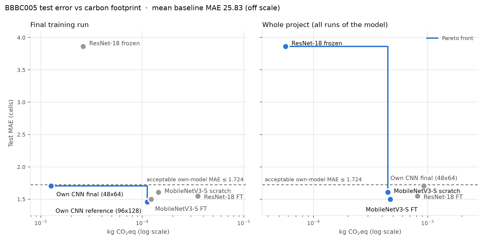

# CSE 655 Term Project — Green CNNs for Image Regression

Status: environment set up; dataset and code not added yet.

## Hardware

- Apple M2 (8-core GPU, 8 GB unified memory), macOS, local training
- Backend: PyTorch with the MPS (Metal) device
- Location for CO2 intensity: Türkiye (`country_iso_code="TUR"`)

## Environment

```bash
conda create -n cse655 python=3.11
conda activate cse655
pip install -r requirements.txt
```

Sanity check (2026-11-08): ResNet-18, 128×128 input, batch 64, AdamW on MPS
runs at about 210 ms/step (~300 img/s).

## Energy measurement

Every run (training, evaluation, searches, failed runs) is wrapped in
`src.energy.measure_run`, which appends one row to `logs/runs.csv`:

```python
from src.energy import measure_run
with measure_run("owncnn_run07", phase="train", model="own_cnn"):
    train(...)
```

Two measurements are taken side by side:

| | Source | Output |
|---|---|---|
| Primary | `src/power_meter.py`: continuous `powermetrics` (CPU+GPU+ANE), 1 s samples, energy = Σ power × elapsed | `logs/power/<run>_<time>.csv`, `meter_*` columns |
| Reference | CodeCarbon 3.3.2 `OfflineEmissionsTracker` (required by the handout) | `logs/codecarbon/emissions.csv`, `cc_*` columns |
| Raw CodeCarbon input | every powermetrics window CodeCarbon read (it overwrites `powermetrics_log.txt` each time) | `logs/codecarbon/raw/<run>_<time>.txt.gz` (`gzip -dc` to read) |

CO2 = kWh × 0.464586 kg/kWh, the Türkiye grid intensity CodeCarbon uses
(`global_energy_mix.json`, 2023).

### One-time setup: passwordless powermetrics

`powermetrics` needs root. `setup/codecarbon_powermetrics.sudoers` allows it
without a password **only with the exact arguments** CodeCarbon and the meter
use (a blanket rule would let any process write root-owned files via `-o`).

```bash
sudo install -m 0440 -o root -g wheel setup/codecarbon_powermetrics.sudoers /etc/sudoers.d/codecarbon_powermetrics && sudo visudo -c
python setup/check_energy.py   # expect "GPU energy measured: OK"
```

Remove with `sudo rm /etc/sudoers.d/codecarbon_powermetrics`.

### Issues found while setting this up (2026-11-08)

1. The handout's snippet `EmissionsTracker(country_iso_code="TUR")` raises
   `TypeError` in CodeCarbon 3.3.2; `country_iso_code` is only accepted by
   `OfflineEmissionsTracker`.
2. Without sudo, CodeCarbon on Apple Silicon falls back to "CPU load mode" and
   reports **GPU power = 0 W**.
3. Even with sudo, CodeCarbon 3.3.2 never reaches powermetrics on Apple
   Silicon: a "CPU load" fast path is tried first and always succeeds when
   psutil is installed. `src/energy.py` disables that fast path when
   powermetrics is usable.
4. With powermetrics active, CodeCarbon still under-counts GPU energy: it
   samples ~1 s per measurement and applies it to the whole interval, and the
   last sample is taken after training stops. Steady ResNet-18 load on the M2:
   raw powermetrics GPU 7–9 W; CodeCarbon average 2.4–5.1 W depending on
   `measure_power_secs`. Hence the continuous meter as the primary number.

Check run (ResNet-18, 128 px, batch 64, 30 s of steps): meter average GPU
6.71 W, CPU 2.68 W, sample coverage 98.7 % of the run.

Limitations: the meter covers the SoC (CPU, GPU, ANE) only — not DRAM,
display, SSD or charger losses. CodeCarbon's numbers additionally include a
RAM power estimate.

## Dataset: BBBC005 v1 (synthetic cells)

- Source: <https://bbbc.broadinstitute.org/BBBC005>. Copyright waived (CC0-style).
  Cite: "We used the image set BBBC005v1 from the Broad Bioimage Benchmark
  Collection [Ljosa et al., Nature Methods, 2012]."
- `BBBC005_v1_images.zip`: 1,882,973,059 bytes,
  SHA-256 `9ab5e7e1d544f5b88f43b6fc8c2236ff63a0659c9ba17b850d43f290d80c6815`.
- 19,200 TIFs, 696×520, 8-bit gray. Name: `SIMCEPImages_<well>_C<count>_F<blur>_s<sample>_w<stain>.TIF`.
  24 count values (1…100), 16 blur levels (F1…F48), 25 samples, 2 stains.
- We use stain w2 (nuclei): **9,600 images**. Target = `count`.
- **Layout reuse:** the same synthetic layout (count, sample) is rendered at
  all 16 blur levels (pixel correlation F1 vs F4 = 0.998; different samples
  0.021). The split is therefore per layout, stratified by count, seed 655:
  17 / 4 / 4 layouts per count → train 6,528 images (408 layouts),
  val 1,536 (96), test 1,536 (96). No layout appears in two splits; every
  split contains all 24 counts and all 16 blur levels.
- Caveat: only 24 distinct count values exist and all appear in every split,
  so the test measures accuracy on seen count values, not interpolation.

## External test sets: real microscopy (test only, never used for training or tuning)

| Set | Cells / stain | Size | Images | Count label | Licence | SHA-256 (zip) |
|---|---|---|---:|---|---|---|
| [BBBC039](https://bbbc.broadinstitute.org/BBBC039) | human U2OS, Hoechst | 520×696, 12-bit in 16-bit TIFF | 200 | exact, from instance masks | CC0 | images `6f30a5d4…ddd7`, masks `f9e6043d…2710` |
| [BBBC002](https://bbbc.broadinstitute.org/BBBC002) | Drosophila Kc167, Hoechst | 512×512, 8-bit | 50 | mean of 2 human counters | not stated on page | `19d74948…009f` |
| [BBBC001](https://bbbc.broadinstitute.org/BBBC001) | human HT29, Hoechst | 512×512, 8-bit | 6 | mean of 2 human counters | CC BY-NC-SA 3.0 | `d6d4ad47…d48` |

Full checksums: `shasum -a 256 data/raw/BBBC0*/*`. Citations: BBBC039v1 Caicedo et al. 2018;
BBBC001v1 / BBBC002v1 Carpenter et al., Genome Biology 2006; all via Ljosa et al., Nature Methods 2012.

`python -m src.external_data` writes `data/external/{bbbc039,bbbc002,bbbc001}.csv`:

| Set | Count min / median / max | > 100 | Nucleus diameter* | Human counters disagree |
|---|---|---:|---|---:|
| BBBC005 (training data) | 1 / 50.5 / 100 | 0 | ~64 px at 696×520 | – |
| BBBC039 | 0 / 124 / 230 (total 23,556) | 140 of 200 | ~28 px at 696×520 | – |
| BBBC002 | 8 / 41.5 / 185 | some | ~19 px at 512×512 | 19.7 % |
| BBBC001 | 249 / 347.5 / 465.5 | all | ~11 px at 512×512 | 9.8 % |

\* Median area of Otsu-thresholded components (BBBC039: mask components), as an
equivalent-circle diameter. BBBC039 mask decoding: red channel = label 1..k,
touching nuclei get different labels, so nucleus = connected component (8-conn.)
of one label; components < 10 px are dropped (23,615 → 23,556).

Consequences for testing: the real nuclei are 2–6× smaller in pixels than the
synthetic ones, and most real images hold more than 100 nuclei. Images must be
rescaled so nuclei have the training size (~11 px at the model input), and
counts above 100 test extrapolation.

## Reproducing results

```bash
mkdir -p data/raw/BBBC005
curl -L -C - -o data/raw/BBBC005/BBBC005_v1_images.zip https://data.broadinstitute.org/bbbc/BBBC005/BBBC005_v1_images.zip
python -m src.data_prep    # -> data/cache/images_w2_{96x128,192x256}.npy, meta_w2.csv
python -m src.baseline     # -> results/baseline.json
```

| Step | Result |
|---|---|
| Preprocessing (box downsampling, both sizes) | 28.3 s, 4.5e-5 kWh |
| Mean / median baseline (both 50.5) | test MAE 25.833, RMSE 29.773, R² 0.000 |

Acceptability thresholds (handout §3.5): MAE_own ≤ 0.6 × 25.833 = **15.50**,
and MAE_own ≤ 1.15 × MAE_best (best standard model, still to be trained).

### Training (validation results; test not yet used)

Common protocol (`src/train.py`): 96×128 input, flips, Huber δ=1, AdamW
(wd 1e-4), batch 64, 1-epoch warm-up + cosine to 0 over **15 epochs**, precise
BN (20 batches) before each validation, best-val-MAE checkpoint. LR per model
from a 25 %-subset, 5-epoch scan (best val MAE).

```bash
python -m src.train --model own --lr 3e-3 --epochs 15 --patience 15 --run-name own_e15
python -m src.train --model resnet18 --pretrained --lr 1e-3 --epochs 15 --patience 15 --run-name resnet18_ft_e15
python -m src.train --model mobilenet_v3_small --pretrained --lr 3e-3 --epochs 15 --patience 15 --run-name mnv3s_ft_e15
python -m src.train --model mobilenet_v3_small --lr 1e-2 --epochs 15 --patience 15 --run-name mnv3s_scratch_e15
python -m src.train_probe --model resnet18 --epochs 15 --run-name resnet18_probe_e15   # frozen backbone
```

| Run | Init | Trainable params | MACs | Best val MAE (epoch) | Train time | Train Wh |
|---|---|---:|---:|---:|---:|---:|
| own_e15 | scratch | 97,457 | 65.5 M | **1.259** (14) | 103 s | 0.242 |
| mnv3s_scratch_e15 | scratch | 1,518,881 | 14.4 M | 1.631 (11) | 181 s | 0.311 |
| resnet18_ft_e15 | ImageNet, full FT | 11,177,025 | 444.1 M | 1.672 (3) | 288 s | 0.762 |
| mnv3s_ft_e15 | ImageNet, full FT | 1,518,881 | 14.4 M | 1.819 (15) | 181 s | 0.263 |
| resnet18_probe_e15 | ImageNet, frozen backbone | 513 | 444.1 M | 3.587 (12) | 22 s | 0.056 |

Earlier configurations kept in the footprint (`logs/runs.csv`): 40-epoch
cosine with early stopping and no precise BN (own_v1, resnet18_ft, mnv3s_ft,
mnv3s_scratch), all LR scans. Project total so far: 30 runs, 4.199 Wh,
1.95 g CO2eq.

### Test evaluation (each final model once)

```bash
for r in own_e15 resnet18_ft_e15 mnv3s_ft_e15 mnv3s_scratch_e15 resnet18_probe_e15 own_green_48x64; do python -m src.evaluate --run $r; done
python -m src.results   # -> results/results.csv, results/acceptability.json
python -m src.plot      # -> results/error_vs_co2.{png,pdf}
```

`src/evaluate.py` refuses to run twice on the same run (test used once).
Before it, the five checkpoints were reloaded and checked to reproduce their
validation MAE exactly (a few seconds of GPU time, not metered).

| Model | Params | MFLOPs/img | Test MAE | RMSE | R² | Train Wh | Train g CO2eq | Project Wh | Project g CO2eq | ms/img (bs 1) | MB | Wh / 1000 pred |
|---|---:|---:|---:|---:|---:|---:|---:|---:|---:|---:|---:|---:|
| Mean baseline | 0 | 0 | 25.833 | 29.773 | 0.000 | – | – | – | – | – | – | – |
| **Own CNN final** (8-16-32, no c5, fp16, 48×64) | 15,257 | 7.5 | 1.704 | 2.110 | 0.9950 | **0.027** | **0.013** | 1.994 | 0.926 | **0.85** | **0.07** | **0.0001** |
| Own CNN reference (16-32-64, 96×128) | 97,457 | 131.0 | **1.458** | 1.855 | 0.9961 | 0.242 | 0.112 | (in row above) | | 1.12 | 0.40 | 0.0006 |
| MobileNetV3-S (ImageNet FT) | 1,518,881 | 28.8 | 1.499 | 1.943 | 0.9957 | 0.263 | 0.122 | 1.014 | 0.471 | 5.62 | 6.21 | 0.0005 |
| ResNet-18 (ImageNet FT) | 11,177,025 | 888.3 | 1.548 | 1.941 | 0.9958 | 0.762 | 0.354 | 1.755 | 0.815 | 4.86 | 44.79 | 0.0018 |
| MobileNetV3-S (scratch) | 1,518,881 | 28.8 | 1.608 | 2.102 | 0.9950 | 0.311 | 0.144 | 0.963 | 0.448 | 6.06 | 6.21 | 0.0006 |
| ResNet-18 (ImageNet, frozen backbone) | 11,177,025 | 888.3 | 3.861 | 4.965 | 0.9722 | 0.056 | 0.026 | 0.122 | 0.057 | 4.82 | 44.79 | 0.0018 |

"Project" = every run of that model family in `logs/runs.csv` (LR scans,
discarded configurations, ablations, seed repeats, final run, test
evaluation, inference benchmark). All own-CNN runs (23) are counted once, in
the final row.

**Choosing the final own model.** After the ablations, two combined "green"
configurations (half width + no c5 + fp16) were trained (`setup/run_green.sh`):
96×128 → val MAE 1.306, 0.099 Wh; 48×64 → val MAE 1.617, 0.027 Wh. The rule
was fixed before training them: take the lowest-energy configuration with val
MAE ≤ 1.15 × best standard val MAE (1.631) − 2 seed SDs = 1.74. Both passed,
so 48×64 was chosen and tested once.

**Acceptability (§3.5):** MAE_best = 1.499 (MobileNetV3-S FT), so the own model
must reach ≤ 1.15 × 1.499 = 1.724 and ≤ 0.6 × 25.833 = 15.50.
- Final own CNN: test MAE 1.704 → **acceptable, but with a margin of only
  0.021**, which is smaller than the seed SD (0.067); the acceptance is not robust.
- Reference own CNN: test MAE 1.458 → acceptable with a margin of 0.27.
- Footprint: the final model's training run uses 9× less energy than the
  reference and 10–28× less than the standard models, and its inference uses
  the least energy per 1,000 predictions. Over the **whole project**, however,
  the own-CNN family (1.99 Wh, mostly ablations and seed repeats) costs more
  than MobileNetV3-S FT (1.01 Wh), which had no ablations.



### Ablations of the own CNN (validation only)

```bash
bash setup/run_ablations.sh   # 2 extra seeds of own_e15 + 5 one-factor ablations
python -m src.ablation        # -> results/ablation.{csv,md}
```

| Factor | Change | Params | MMACs | Val MAE | ΔMAE (in seed SDs) | Train Wh | ΔWh |
|---|---|---:|---:|---:|---:|---:|---:|
| Reference (3 seeds) | own_e15 config | 97,457 | 65.5 | 1.287 ± 0.067 | – | 0.227 | – |
| Pooling | sum -> global average + linear | 97,457 | 65.5 | 1.203 | -0.084 (-1.3) | 0.219 | -4 % |
| Receptive field | drop c5: RF 46 -> 30 px | 60,465 | 58.4 | 1.257 | -0.030 (-0.4) | 0.201 | -11 % |
| Input resolution | 96x128 -> 48x64 | 97,457 | 16.4 | 1.414 | +0.127 (+1.9) | 0.053 | -77 % |
| Width | 16-32-64 -> 8-16-32 channels | 24,537 | 16.8 | 1.238 | -0.049 (-0.7) | 0.091 | -60 % |
| Precision | fp32 -> fp16 autocast (training) | 97,457 | 65.5 | 1.237 | -0.051 (-0.8) | 0.198 | -13 % |

ΔMAE is relative to the 3-seed reference mean; the value in brackets is that
difference in units of the seed standard deviation (0.067), so |Δ| below ~2
SDs is within seed noise. ΔWh is the change in final-training energy.

To be filled in: external real-microscopy test.
